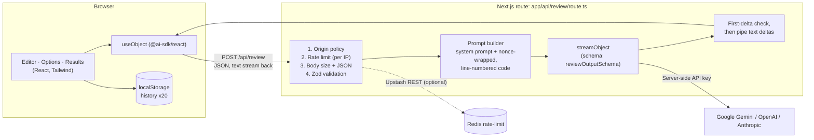

# ReviewForge

AI code review that streams structured findings live. Paste code (or drop a file), pick a language and a review focus, and get a score, a two-line summary, and line-accurate finding cards with severity, a copy-ready fix diff, and a copy button.

It is a purpose-built review tool, not a chat UI.

## Features

- **Editor**: monospace input with synced line numbers, language selector with auto-detect, file upload (`.js .ts .py .java .cpp .c .cs .go .rs .rb .php .kt .swift .sql .sh`), character counter (12,000 max), "Load sample code".
- **Focus and strictness**: Bugs, Security, Performance, Readability, Best Practices, plus Chill / Standard / Ruthless calibration.
- **Live results**: `useObject` + `streamObject` render finding cards as they stream. Filter by severity and category, sort, Stop generating, Regenerate.
- **History**: last 20 reviews in `localStorage`. Reopen, rename, delete.
- **Export and share**: copy as Markdown, download `.md`, shareable read-only link (review encoded in the URL fragment, so it is never sent to a server).
- **Security**: server-only API key, Zod validation, per-IP rate limiting (Upstash or in-memory), prompt-injection hardening, timeouts, generic client errors, security headers, origin policy.
- **AI providers**: Google Gemini, OpenAI, or Anthropic through the Vercel AI SDK. Google AI Studio offers a free-tier API key subject to Google's model availability, rate limits, and terms.

## Technologies

- Next.js 16 App Router, React 19, and TypeScript
- Tailwind CSS 4
- Vercel AI SDK with Google Gemini, OpenAI, and Anthropic providers
- Zod for request and review schema validation
- Drizzle ORM and PostgreSQL for the optional health-check database
- Upstash Redis for optional shared rate limiting
- Vitest for unit tests

## Architecture



### Project structure

```text
.
├── src/
│   ├── app/
│   │   ├── api/
│   │   │   ├── health/route.ts       # Service and optional database health check
│   │   │   └── review/route.ts       # Validates requests and streams AI findings
│   │   ├── share/page.tsx            # Read-only shared-review page
│   │   ├── globals.css               # Global styles and Tailwind entry point
│   │   ├── layout.tsx                # Root layout and metadata
│   │   └── page.tsx                  # Landing page and review workspace entry
│   ├── components/                   # Editor, options, history, findings, results, UI
│   ├── db/                           # Drizzle database client and schema
│   ├── hooks/                        # Client-side review history hook
│   ├── lib/                          # AI provider, prompts, rate limiting, guards, helpers
│   ├── schemas/                      # Zod request, finding, and saved-review schemas
│   └── __tests__/                    # Vitest unit tests
├── .env.example                      # Safe environment-variable template
├── drizzle.config.json               # Drizzle ORM configuration
├── next.config.ts                    # Next.js and security-header configuration
├── package.json                      # Scripts and runtime/development dependencies
├── postcss.config.mjs                # Tailwind CSS/PostCSS configuration
├── tsconfig.json                     # TypeScript configuration
└── vitest.config.mts                 # Vitest configuration
```

Key files:

| Path | Purpose |
| --- | --- |
| `src/app/api/review/route.ts` | The only place that talks to the LLM. Validation, rate limit, timeouts, error mapping. |
| `src/schemas/review.ts` | Single source of truth: allowlists, request schema, output schema, saved review schema. |
| `src/lib/prompt.ts` | System prompt (persona, strictness, focus, injection rules) and user-prompt wrapping. |
| `src/lib/llm.ts` | Provider factory for Google Gemini, OpenAI, and Anthropic. |
| `src/lib/rate-limit.ts` | Upstash sliding window with an in-memory fallback. |
| `src/lib/request-guard.ts` | Client IP extraction and CORS / origin policy. |
| `src/lib/review-utils.ts` | Sorting, Markdown export, share-link encoding and validation. |
| `src/hooks/use-review-history.ts` | Validated localStorage history (cap of 20). |
| `src/components/*` | Editor, options, results, finding cards, history sidebar, error banner, landing hero. |
| `src/app/share/page.tsx` | Read-only view that decodes the URL fragment on the client. |
| `src/__tests__/*` | Unit tests for validation, schemas, prompt construction, sharing, rate limiting, origin policy. |

### Request lifecycle

1. The client validates input (empty, whitespace, over-length, no focus) and shows inline errors before any request.
2. `POST /api/review` checks the origin, applies the per-IP rate limit (429 + `Retry-After`), enforces a 64 KB body cap, and validates with Zod (400 with human-readable messages).
3. The server starts `streamObject` with a combined signal: client abort plus a 50 s timeout.
4. The server waits for the first text delta before responding. Provider failures (bad key, 429 upstream, timeouts) therefore return a real HTTP status. Later failures error the stream, and the client shows a retry banner.
5. The client classifies errors by HTTP status (network, rate limit, provider, timeout, validation, config) and shows a banner with Retry.

## Setup

Requirements: Node.js 20+ and npm. PostgreSQL is optional and is only used by the `/api/health` route. A provider API key is needed to generate live AI reviews.

```bash
npm install
cp .env.example .env
npm run dev                   # http://localhost:3000
```

On Windows PowerShell, use `Copy-Item .env.example .env` instead of `cp`. Add a valid provider key to `.env` before submitting reviews; keep this file local and never commit it. For Gemini, set `LLM_PROVIDER=google`, `LLM_MODEL=gemini-2.5-flash`, and `GEMINI_API_KEY` (or `GOOGLE_GENERATIVE_AI_API_KEY`). Get a key from [Google AI Studio](https://aistudio.google.com/apikey). The project does not generate or provide API keys. Set `DATABASE_URL` only if you want `/api/health` to connect to PostgreSQL.

The development server uses port 3000 by default and selects another available port if 3000 is already occupied.

Run the tests:

```bash
npx vitest run
```

Run the code checks:

```bash
npm run lint
npm run typecheck
```

Production build:

```bash
npm run build && npm start
```

## Environment variables

| Variable | Required | Default | Notes |
| --- | --- | --- | --- |
| `LLM_PROVIDER` | No | `google` | `openai`, `anthropic`, or `google` (Gemini free-tier keys work with Google). |
| `LLM_MODEL` | No | `gemini-2.5-flash` / `gpt-4.1-mini` / `claude-sonnet-4-5` | Any model ID the provider supports. |
| `LLM_API_KEY` | **Yes** | none | Server-only secret. `GEMINI_API_KEY` / `GOOGLE_GENERATIVE_AI_API_KEY` also work automatically. Never prefix with `NEXT_PUBLIC_`. |
| `RATE_LIMIT_PER_MINUTE` | No | `10` | Per client IP. |
| `UPSTASH_REDIS_REST_URL` / `_TOKEN` | Recommended in prod | unset | Shared limiter across serverless instances. Without them, the limiter is per instance. |
| `ALLOWED_ORIGINS` | No | empty | Extra comma-separated origins allowed to call the API. Same-origin is always allowed. |
| `DATABASE_URL` | No | unset | PostgreSQL connection for `/api/health`; not needed for reviews. |

## Deploy to Vercel

1. Push the repo and import it in Vercel.
2. Add `LLM_PROVIDER`, `LLM_MODEL`, `LLM_API_KEY`, and (recommended) the two Upstash variables in Project Settings → Environment Variables.
3. Deploy. `/api/review` runs on the Node.js runtime with `maxDuration = 60`.

## Privacy

Code is sent to the configured LLM provider to produce the review. ReviewForge does not write code to a database or log file. Review history lives in the user's browser (`localStorage`). Share links carry the review in the URL fragment, which browsers do not send to the server, so anyone with the link can read it. The server logs only error class and status, never code or keys.

## Security notes

- The API key is read only in `src/lib/llm.ts` on the server and is never returned to the client.
- User code is wrapped in a per-request random boundary and labelled as untrusted data. The system prompt tells the model to ignore instructions inside the code and to report manipulation attempts as a security finding.
- Errors are generic to the client. Stack traces and provider messages stay in server logs.
- Security headers (`nosniff`, `X-Frame-Options: DENY`, HSTS, Referrer and Permissions policies, and a CSP) are set in `next.config.ts`.
- Cross-origin POSTs are rejected unless listed in `ALLOWED_ORIGINS`.

## API endpoints

| Method and path | Purpose |
| --- | --- |
| `POST /api/review` | Validates review input and streams structured findings from the configured AI provider. |
| `OPTIONS /api/review` | Handles allowed cross-origin preflight requests. |
| `GET /api/health` | Reports service health and checks PostgreSQL only when `DATABASE_URL` is configured. |
| `GET /share#...` | Renders a read-only review encoded in the URL fragment; the fragment is not sent to the server. |

## npm scripts

| Command | Purpose |
| --- | --- |
| `npm run dev` | Start the local Next.js development server. |
| `npm run build` | Create a production build. |
| `npm start` | Serve the production build. |
| `npm run lint` | Run ESLint. |
| `npm run typecheck` | Run TypeScript without emitting files. |
| `npx vitest run` | Run the unit tests once. |

## Screenshots

Screenshots are not included yet.
